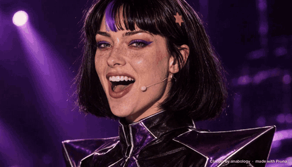

# LOW LATENCY

A 2:31 AI music video. Every shot was lip-synced with [Pruna](https://www.pruna.ai)'s video models, and the
video generation for the final cut cost **$6.69**.

Claudia is the open AI pop-star character by [anabology](https://claudia.gallery). This film is fan work. The song
is about the tricks that make AI models smaller and faster: prune, distill, fuse, quantize, cache, compile.

This repo holds everything we used to make it: the code, the storyboard, every prompt, the stills, the word timings
and the receipts. Fork it and make your own Claudia film.

## Make Claudia sing any song (a few minutes, about $0.60)



Give it a song (a Suno track works) or a voice memo of you singing. One command turns 10–20 seconds of it into a
finished, lip-synced shot: Claudia sings it on stage, and the lyrics build behind her word by word, in the film's
typography.

```
git clone https://github.com/LeRayan/claudia-low-latency && cd claudia-low-latency
cp .env.example .env                      # add PRUNA_API_KEY and REPLICATE_API_TOKEN
pip install -r requirements.txt           # numpy and pillow; you also need ffmpeg
python quickstart.py                      # the demo: the film's chorus (the clip above), about $0.60
python quickstart.py --song my_song.mp3 --start 42 --lyrics "the words she sings"   # 20 s of any song, from 0:42
python quickstart.py --audio my_voice.m4a # or your own voice
```

- **Pick another shot** with `--plate L03`: any of the 20 plates in [`v2/plates/`](v2/plates), or your own image of
  her.
- **Songs:** `--song` splits out the vocal first (Demucs, about a cent) and lip-syncs to that alone, with the song
  playing under her. The full mix gives mushy mouths.
- **Lyrics on screen:** pass the words with `--lyrics`. With `--song`, no lyrics are drawn without them: speech
  recognition on a sung mix guesses words. Even with the words it can drop a stretch of a fast line, so check the
  clip; verses time better than chants and stacked choruses.
- **What it does:** it renders her with Pruna's `p-video-2-pro-avatar` ($0.04 per second), times your words with
  WhisperX, cuts her out of every frame with BiRefNet, and sets your lyrics behind her. The clip lands in `out/`,
  with a small credit in the corner.
- **Every run is logged** to `spend.csv`.
- **Sync is checked, not assumed:** the quickstart snaps your lyrics to the sung attacks and, with
  `pip install -r requirements-verify.txt`, checks her lips word by word (`scripts/verify_sync.py`, skill `verify-sync`).

If you post one, credit "Claudia by anabology, made with Pruna". We'd love to see it.

## The receipts

| | |
|---|---|
| Video generation for the final cut | **$6.69**, for 20 lip-synced shots (161 s rendered at 768p) |
| Every video take we ever generated | $69.31, for 222 takes and 28 minutes of footage, across two films |
| Everything (stills, stems, mattes, every failed take, an earlier film) | $147.07 |

The full log is in [`receipts/spend.csv`](receipts/spend.csv). That works out to $2.44 per minute of generated
video.

## The stack

- **Song:** [Suno](https://suno.com) v6. The style prompt and lyrics are in [`v2/song.md`](v2/song.md).
- **Stills:** GPT Image 2.5 Sunburst on Replicate (`scripts/sunburst.py`, `scripts/plates.py`).
- **Video:** Pruna `p-video-2-pro-avatar` for the sung close-ups and `p-video-2-pro-reference` for the action
  worlds (`scripts/avatar_shots.py`, `scripts/clips.py`).
- **Everything else is code:** the storyboard, the edit, the word timings, the mattes and the lyric typography.
- **Production:** [Claude Code](https://claude.com/claude-code) directed it end to end. A human (Rayan) gave the
  notes.

## How the film is made

1. **Song.** Write the lyric and style in `v2/song.md` and generate it in Suno. Split out her vocal with Demucs on
   Replicate (`cjwbw/demucs`).
2. **Character.** Make one identity sheet with Sunburst ([`v2/identity-sheet.jpg`](v2/identity-sheet.jpg)). It
   becomes the reference image for every shot.
3. **Storyboard.** `v2/make_board.py` writes `v2/board.json` and `v2/board.md`: 20 shots, each with its lyric, its
   world, its plate prompt and its cut points. Cuts never fall inside a word.
4. **Plates.** `scripts/plates.py` makes one still per shot. The picks are in `v2/plates/`.
5. **Video.** Every shot is rendered from her isolated vocal, not the full mix, which gives crisp mouths. The exact
   prompt and settings for each take in the final cut are in `v2/prompts/`.
6. **Edit.** `edit/assemble.py` cuts every take on the song's own frames, so nothing drifts.
7. **Word clock.** `scripts/force_align.py` and `scripts/word_clock.py` give one trusted start time per sung word.
   See below.
8. **Mattes.** `scripts/birefnet_frames.py` and `scripts/matte_build.py` cut her out of every frame, so the lyrics
   can sit behind her.
9. **Lyrics.** `edit/lockups.py` draws every line as a typographic block behind her, built word by word.
   [`v2/lockups.json`](v2/lockups.json) says how each line is set.

The settings for the whole film are in `projects/v2.json`. The heavy media (song, stems, clips, full-size plates) is
not in the repo; the code expects it under `v2/audio/`, `v2/clips/` and `v2/plates/`.

## The fun part: the producer can't hear

Claude Code can't listen to the song. To land each lyric on screen on the frame she sings it, it read her isolated
vocal as a spectrogram, row by row, with every word marked. In the process it caught Suno's own word timing a full
second off: Suno glued the start of a held "Fuuuse" to the end of the previous line.

The word clock combines three sources:
- Suno's alignment, which runs about 110 ms late;
- forced alignment of the known lyric with wav2vec2, trusted only where it agrees with Suno;
- the vocal's own attacks.

Where all three were wrong, the measured fix is in `v2/audio/word_overrides.json`, with the reason written next to
it.

## What's inside

- [LESSONS.md](LESSONS.md): everything that worked and everything that failed, across two films.
- **Sync verification** (`scripts/verify_sync.py`, skill `verify-sync`): measures lyric timing against the vocal and
  lip sync per shot, and fixes the lyric clock. LESSONS.md, "Sync, verified", has how we got it wrong first.
- [PROMPTS.md](PROMPTS.md): the prompt patterns for the identity sheet, plates, sung close-ups, action worlds and the
  song, and why each one reads the way it does.
- [CHARACTERS.md](CHARACTERS.md): how to make believable new characters in an open character's style, and an honest
  section on fighting the model's defaults (and ours). It comes with its own skill, `character-variants`.
- **A Claude Code skill** in [`.claude/skills/claudia-music-video/`](.claude/skills/claudia-music-video/SKILL.md).
  Clone the repo, run `claude` inside it and say "make me a Claudia music video": it walks the whole method, with a
  checkpoint wherever a human should pick.

The three biggest lessons:
1. Lip-sync from the isolated vocal, never the full mix.
2. Keep faces big. Small faces get glitchy eyes.
3. Draw the lyrics in code instead of generating them. Code is precise, and less is more.

## Setup

```
cp .env.example .env            # REPLICATE_API_TOKEN, PRUNA_API_KEY
pip install -r requirements.txt                  # everything except the forced aligner
pip install -r requirements-align.txt            # torch + transformers, for scripts/force_align.py only
```

You also need ffmpeg. On macOS the lyrics use the film's fonts (Helvetica Neue, Baskerville); elsewhere they fall
back to the open fonts in `assets/fonts` (Anton and Libre Baskerville, SIL Open Font License). Scripts that call an API log what they spend to `spend.csv`.

## Credit and terms

- **Claudia is an open character by anabology (claudia.gallery).** Her canon and much of the method are theirs. One
  honest note: in her canon the streak is clay-orange (#D97757); for LOW LATENCY we gave her a purple one to match
  the film's palette. Read their notes and watch the originals at
  [claudia.gallery](https://claudia.gallery); the character's terms of use are at
  [claudia.gallery/use](https://claudia.gallery/use/).
- The code in this repo is MIT-licensed. The song, the film and the stills are ours; credit "LOW LATENCY: Claudia by
  anabology, made with Pruna" if you share them.
- Not affiliated with Anthropic.
